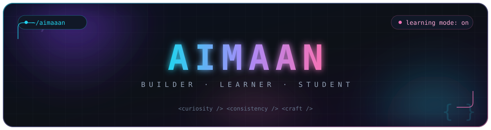

<div align="center">



<a href="https://git.io/typing-svg">
  
</a>

<br/>

**Builder and learner exploring full-stack and cloud.**<br/>
<sub>Turning curiosity into projects, one commit at a time.</sub>

<a href="https://github.com/Aimaaaan">
  
</a>


</div>

---

### `$ whoami`

```ts
const aimaan = {
  role: "Student",
  mindset: ["builder", "learner"],
  stack: ["TypeScript", "Python", "HTML/CSS", "AWS"],
  currently: "building projects and learning along the way",
  favoritePlace: "workshops and side quests",
};
```

### `$ ls tech/`

<p align="center">
  
</p>

### `$ git log --stats`

<p align="center">
  
  
</p>

<p align="center">
  
</p>

### `$ ls projects/`

<table>
  <tr>
    <td width="50%" valign="top">
      <h3><a href="https://github.com/Aimaaaan/workshop-3">workshop-3</a></h3>
      <p><sub>Tailspin Toys — a static crowdfunding site for fictional games, built with Astro, Tailwind CSS, and Drizzle ORM over SQLite.</sub></p>
      <p>
        
        
        
        
      </p>
    </td>
    <td width="50%" valign="top">
      <h3><a href="https://github.com/Aimaaaan/travelgo">travelgo</a></h3>
      <p><sub>TravelGo — a Flask travel-booking platform with search, bookings, and a dashboard, deployed on AWS.</sub></p>
      <p>
        
        
        
        
        
      </p>
    </td>
  </tr>
  <tr>
    <td width="50%" valign="top">
      <h3><a href="https://github.com/Aimaaaan/MP--OD-Trial">MP--OD-Trial</a></h3>
      <p><sub>A security-focused full-stack project with a FastAPI + PostgreSQL backend and a React frontend.</sub></p>
      <p>
        
        
        
        
        
      </p>
    </td>
    <td width="50%" valign="top">
      <h3><a href="https://github.com/Aimaaaan/Fish_Disease_Detection_Frontend">Fish_Disease_Detection_Frontend</a></h3>
      <p><sub>A Next.js frontend for a fish disease detection app, with auth, theming, and motion.</sub></p>
      <p>
        
        
        
        
      </p>
    </td>
  </tr>
</table>

<p align="center">
  <a href="https://github.com/Aimaaaan?tab=repositories"><b>See all repositories →</b></a>
</p>

### `$ tail -f contributions`

<p align="center">
  <picture>
    <source media="(prefers-color-scheme: dark)" srcset="https://raw.githubusercontent.com/Aimaaaan/Aimaaaan/output/snake-dark.svg" />
    <source media="(prefers-color-scheme: light)" srcset="https://raw.githubusercontent.com/Aimaaaan/Aimaaaan/output/snake.svg" />
    
  </picture>
</p>

---

<div align="center">

### `$ echo "let's build something"`

<a href="https://github.com/Aimaaaan">
  
</a>


<sub>Thanks for stopping by.</sub>

</div>